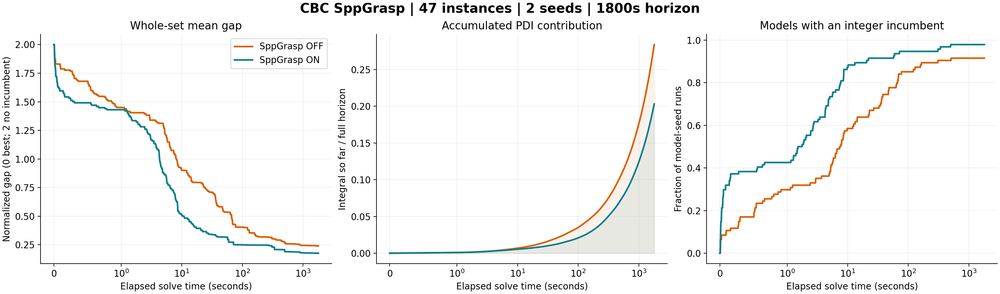
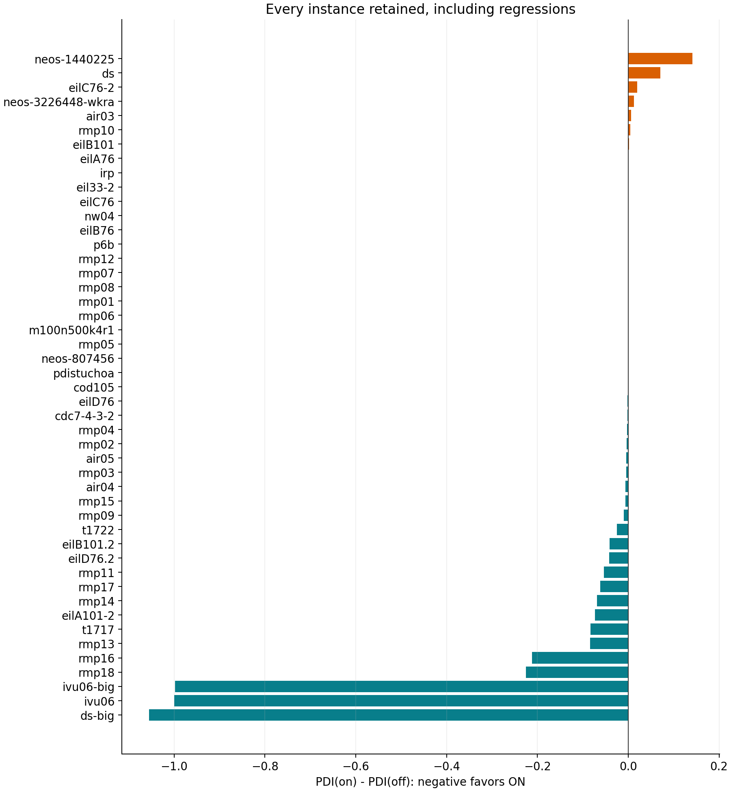

# CBC SppGrasp: whole-collection paired results

**COMPLETE:** all 191 planned runs validated; 47 models x 2 seeds per arm; T=1800s.

Mean PDI: **0.283802 off -> 0.202987 on (-28.48%)**. Paired mean difference 95% instance-bootstrap interval: [-0.160580, -0.018101].
This interval describes this selected instance set, not an unseen population.

| Metric | Off | On |
|---|---:|---:|
| Validated optimal solves by horizon | 52 | 50 |
| Mean PDI (lower is better) | 0.283802 | 0.202987 |
| Mean elapsed seconds (actual final clock) | 834.418 | 857.477 |
| Mean elapsed seconds capped at T | 834.357 | 857.419 |
| No incumbent by horizon | 8 | 2 |
| Unknown dual by horizon | 6 | 4 |
| Mean final relative gap %, same 86 pairs | 8.5059 | 8.69963 |
| Mean normalized terminal gap penalty (all runs) | 0.240556 | 0.176627 |

The conventional relative gap uses |p-d|/max(|p|,1e-10). It is not the bounded, symmetric PDI gap; missing incumbents are separate.

## Proof and terminal-gap transitions

Proof gains: none.
Proof losses: eilC76-2/6401, eilC76-2/6402.

Terminal relative-gap regressions >0.01 percentage points:

- ds/6401: 70.1041% -> 89.4115%
- ds/6402: 73.9135% -> 84.0353%
- eilA101-2/6401: 20.7227% -> 22.5975%
- eilA101-2/6402: 14.2563% -> 24.7236%
- eilB101.2/6402: 7.92215% -> 11.4253%
- eilC76-2/6401: 0% -> 4.77176%
- eilC76-2/6402: 0% -> 4.48503%
- rmp11/6401: 6.11115% -> 10.8772%
- rmp11/6402: 5.27074% -> 8.92147%
- rmp13/6401: 0.0206125% -> 0.0431841%
- rmp13/6402: 0.0468845% -> 0.0803061%
- rmp14/6402: 0.276637% -> 0.363786%
- rmp18/6402: 0.506346% -> 0.523995%
- t1717/6401: 29.4914% -> 32.0854%
- t1717/6402: 30.1152% -> 31.0379%

## Individual models (all seeds averaged)

| Model | Off PDI | On PDI | On - off | Off optimal | On optimal |
|---|---:|---:|---:|---:|---:|
| ds-big | 2.000000 | 0.944787 | -1.055213 | 0 | 0 |
| ivu06 | 2.000000 | 1.000705 | -0.999295 | 0 | 0 |
| ivu06-big | 2.000000 | 1.002355 | -0.997645 | 0 | 0 |
| rmp18 | 0.278991 | 0.053972 | -0.225019 | 0 | 0 |
| rmp16 | 0.593474 | 0.381637 | -0.211837 | 0 | 0 |
| rmp13 | 0.094192 | 0.009918 | -0.084274 | 0 | 0 |
| t1717 | 0.412149 | 0.329022 | -0.083127 | 0 | 0 |
| eilA101-2 | 0.321042 | 0.248144 | -0.072898 | 0 | 0 |
| rmp14 | 0.086148 | 0.017322 | -0.068826 | 0 | 0 |
| rmp17 | 0.266858 | 0.204865 | -0.061993 | 0 | 0 |
| rmp11 | 0.159711 | 0.106557 | -0.053154 | 0 | 0 |
| eilD76.2 | 0.128190 | 0.086572 | -0.041618 | 0 | 0 |
| eilB101.2 | 0.155805 | 0.114868 | -0.040937 | 0 | 0 |
| t1722 | 0.259382 | 0.234795 | -0.024587 | 0 | 0 |
| rmp09 | 0.014700 | 0.004609 | -0.010091 | 2 | 2 |
| rmp15 | 0.009192 | 0.003010 | -0.006182 | 2 | 2 |
| air04 | 0.012589 | 0.006778 | -0.005812 | 2 | 2 |
| rmp03 | 0.006995 | 0.002725 | -0.004270 | 2 | 2 |
| air05 | 0.009322 | 0.005309 | -0.004013 | 2 | 2 |
| rmp02 | 0.005826 | 0.002752 | -0.003073 | 2 | 2 |
| rmp04 | 0.005723 | 0.003492 | -0.002231 | 2 | 2 |
| cdc7-4-3-2 | 0.845290 | 0.843647 | -0.001643 | 0 | 0 |
| eilD76 | 0.006633 | 0.005153 | -0.001480 | 2 | 2 |
| cod105 | 0.318431 | 0.317954 | -0.000477 | 0 | 0 |
| pdistuchoa | 0.227896 | 0.227708 | -0.000189 | 0 | 0 |
| neos-807456 | 2.000000 | 2.000000 | +0.000000 | 0 | 0 |
| rmp05 | 0.000012 | 0.000012 | +0.000001 | 2 | 2 |
| m100n500k4r1 | 0.040361 | 0.040363 | +0.000002 | 0 | 0 |
| rmp06 | 0.000008 | 0.000011 | +0.000003 | 2 | 2 |
| rmp01 | 0.003283 | 0.003290 | +0.000007 | 2 | 2 |
| rmp08 | 0.000011 | 0.000021 | +0.000010 | 2 | 2 |
| rmp07 | 0.000027 | 0.000044 | +0.000017 | 2 | 2 |
| rmp12 | 0.000107 | 0.000159 | +0.000052 | 2 | 2 |
| p6b | 0.074021 | 0.074111 | +0.000089 | 0 | 0 |
| eilB76 | 0.000642 | 0.000790 | +0.000148 | 2 | 2 |
| nw04 | 0.003497 | 0.003734 | +0.000237 | 2 | 2 |
| eilC76 | 0.001512 | 0.002315 | +0.000803 | 2 | 2 |
| eil33-2 | 0.003767 | 0.004647 | +0.000880 | 2 | 2 |
| irp | 0.001399 | 0.002461 | +0.001062 | 2 | 2 |
| eilA76 | 0.001306 | 0.002488 | +0.001183 | 2 | 2 |
| eilB101 | 0.004807 | 0.006342 | +0.001535 | 2 | 2 |
| rmp10 | 0.006062 | 0.010826 | +0.004764 | 2 | 2 |
| air03 | 0.001003 | 0.007170 | +0.006166 | 2 | 2 |
| neos-3226448-wkra | 0.058851 | 0.071409 | +0.012558 | 2 | 2 |
| eilC76-2 | 0.032261 | 0.051777 | +0.019516 | 2 | 0 |
| ds | 0.807499 | 0.878650 | +0.071151 | 0 | 0 |
| neos-1440225 | 0.079734 | 0.221098 | +0.141364 | 2 | 2 |

## Duplicate off controls

| Model | Initial off PDI | Repeated off PDI | Repeat - initial |
|---|---:|---:|---:|
| air03 | 0.001020 | 0.000939 | -0.000082 |
| ds | 0.789272 | 0.777564 | -0.011708 |
| rmp03 | 0.006986 | 0.006250 | -0.000736 |

Off-before-on order, concurrent load, prior development exposure and the selected structural population limit generalization. Enabling the parameter includes existing FPump/native-completion interactions; this is not an isolated LNS microbenchmark.

Machine-readable values: [runs.tsv](runs.tsv), [paired.tsv](paired.tsv), [summary.json](summary.json). Provenance: [manifest.json](manifest.json).
