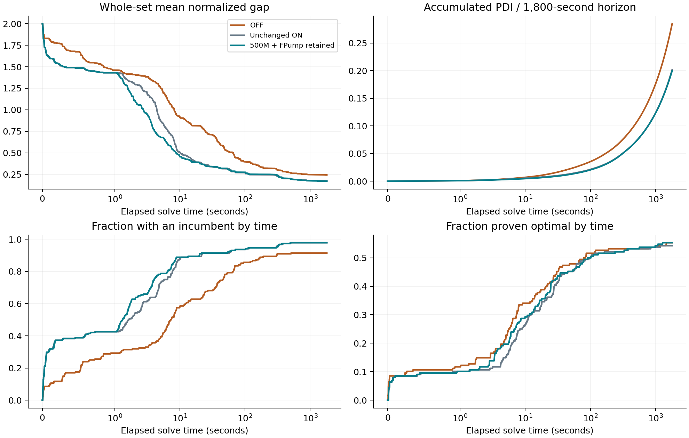
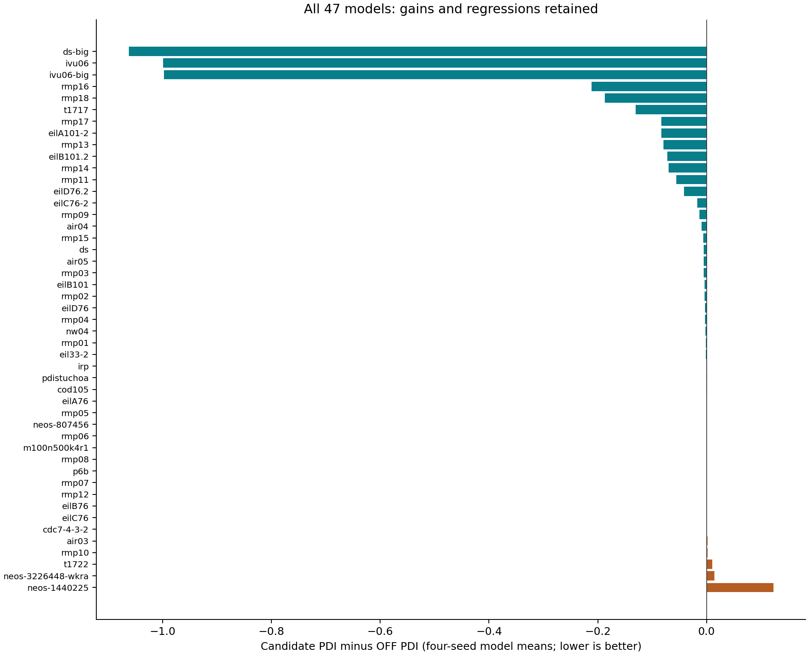

# Executive result

The tested 500M-work candidate lowers whole-collection mean PDI by **29.85% versus OFF**, preserves **every one of OFF's 104 optimal solves**, and reduces runs with no incumbent from **16 to 4**. It recovers both proofs lost by unchanged ON on `eilC76-2` (seeds 6401 and 6402). There are no proof gains or losses versus OFF.

**This is not a regression-free or universal-dominance claim.** Mean runtime is 839.85 s versus 839.42 s for OFF (+0.43 s); individual PDI and final-gap regressions remain. The candidate matches, rather than exceeds, OFF's optimal count. No AUTO mode or default change has been implemented by this experiment.

# Whole-collection results

| Metric | OFF | Unchanged ON | 500M + FPump retained |
|:--|--:|--:|--:|
| Validated optimal solves / 188 | 104 | 102 | 104 |
| Mean PDI (lower is better) | 0.285123 | 0.201818 | 0.200023 |
| Mean elapsed seconds | 839.42 | 849.18 | 839.85 |
| No incumbent at 1,800 s | 16 | 4 | 4 |
| Mean final gap %, same 172 pairs | 8.832 | 8.522 | 8.275 |

Paired mean PDI difference, candidate minus OFF: **-0.085100**; descriptive 95% instance-bootstrap interval **[-0.166489, -0.022779]**. All seeds of each instance are resampled together (10,000 samples). This interval is conditional on the selected collection, not an estimate for unseen MIPs.

# What was tested

The collection contains **47 SPP-dominant instances**: 29 pure binary set packing/partitioning models and 18 separately labeled supplemental RMP application models. Seventeen are from MIPLIB 2017; 30 are collected application instances. At least 90% of original rows must be packing or partitioning (actual minimum 92.044%). The feature table and inputs were frozen before the original performance study.

All 47 models were run in all three arms with four matched seeds: **6401, 6402, 6601, 6602**. Each solve received **1,800 elapsed seconds**; 16 independent serial CBC processes (`-threads 0`) ran concurrently, with BLAS/OpenMP restricted to one thread. Task order was shuffled with scheduling seed 6500. All **564 planned runs validated**.

| Arm | Explicit settings |
|:--|:--|
| OFF | `-sppGrasp off` |
| Unchanged ON | `-sppGrasp on` |
| Candidate | `-sppGrasp on -sppGraspWork 500 -sppGraspFpump on` |

`sppGraspWork 500` is 500 million counted work units per call, not 500 seconds or a hard whole-solve work budget. `sppGraspFpump on` prevents automatic disabling; it does not force FPump to perform LP passes when an incumbent already exists. Existing applicability, native completion and all other search defaults remain in effect.

The arms use the **same frozen optimized, Nauty-free executable** and dependencies. No model-name gate, input-model modification, forced applicability or per-instance parameter tuning was applied to the candidate. Existing automatic artificial-slack behavior is retained.

# PDI and solution validation

PDI is the average normalized primal-dual gap over the common 1,800-second horizon. Gap is 2 without an incumbent, 1 with an incumbent but no usable dual bound (or opposite signs), otherwise `abs(primal-dual)/max(abs(primal),abs(dual))`, with the analyzer's zero-gap convention for equal zero bounds. Lower is better. An optimality/infeasibility proof closes the gap at its actual timestamp; a stopped run holds its last gap to the horizon.

Every history uses the complete progress CSV, including original-model incumbents and a positive global final timestamp. No missing CSV or fractional LP relaxation is converted into an integer solution. An independent validator checks genuine incumbents against bounds, integrality, every row and objective; reference objectives cross-check proof claims. Failed or missing runs block complete reporting.

Conventional final relative gap uses `abs(p-d)/max(abs(p),1e-10)` and is averaged only over the same 172 finite-bound/incumbent pairs in all arms. It differs from the normalized PDI gap.

\newpage

# Finding solutions and proving optimality over time

{width=100%}

# Original and fresh seeds

Original seeds deliberately revisit the earlier proof losses. Fresh seeds provide seed-based replication on the same models, not an independent-instance holdout.

## Original seeds

| Arm | Optimal / 94 | Mean PDI | Mean seconds | No incumbent |
|:--|--:|--:|--:|--:|
| OFF | 52 | 0.283897 | 832.57 | 8 |
| Unchanged ON | 50 | 0.203019 | 857.56 | 2 |
| 500M + FPump retained | 52 | 0.200525 | 836.52 | 2 |

## Fresh seeds

| Arm | Optimal / 94 | Mean PDI | Mean seconds | No incumbent |
|:--|--:|--:|--:|--:|
| OFF | 52 | 0.286349 | 846.26 | 8 |
| Unchanged ON | 52 | 0.200617 | 840.80 | 2 |
| 500M + FPump retained | 52 | 0.199521 | 843.18 | 2 |

\newpage

# Individual-model effects

Each bar averages four matched seeds; negative favors the candidate. Regressions are retained, not omitted.

{width=95%}

\newpage

# Interpretation for AUTO

Forrest's concern is valid: AIR03 profiling exposed expensive local search, and his 44-problem unit-test timing increased from about 85.4 s to 95.3 s when SppGrasp was enabled. This study does not refute that measurement or establish that a broad default should always execute full SppGrasp.

The evidence supports an **AUTO policy proposal**, not simply renaming unchanged ON. The tested starting point is existing structural applicability plus a 500M per-call work limit and preservation of FPump availability, while retaining safe pre-LP native completion. A general AUTO implementation still needs explicit semantics, user-override preservation, and broader non-SPP/quick-suite validation. A cheap structural skip and effort control are hypotheses for that implementation, not separately proven adaptive decisions here.

The 500M candidate was selected from a seven-policy screen on 11 models. The confirmation uses all 47 models and fresh seeds but the collection has tuning/development exposure. Do not describe it as unseen-instance validation, or assert a guarantee of no regressions. Timing under concurrent load is noisy; the 0.43 s aggregate runtime difference is reported, not claimed statistically equivalent.

# Reporting fixes and reproducibility

A previous confirmation finished with only 562/564 valid runs: an OFF `ivu06/6602` preprocessing timeout omitted its CSV, while an ON timeout reported a saved incumbent but exported the fractional LP vector. Both original failures remain preserved. A reporting-only fix restores the saved integer vector and finalizes progress on that early return. The full 564-run round was restarted with the same repaired binary in all arms; no old/new results were mixed.

Baseline: `coin-or/Cbc@97ca70c7` (master, OFF default). Reporting-only source: `f7ef1ae9` (full revision in the manifest), including initial-LP and preprocessing-timeout repairs. It does not import unrelated next heuristic changes. Focused timeout probes fail on the old build and pass after the repair; native/progress/objective-offset, solver quick, callback and bound tests passed. Nauty was excluded from every arm.

The result directory includes the exact manifest, all source revisions, commands, input/binary/runtime-library hashes, combined source patch, per-run metrics, proof transitions and gap regressions. Raw evidence and frozen executables accompany the experiment release.

# References

- [Dataset, model characteristics and attribution](https://github.com/h-g-s/set-packing-partitioning-instances)
- [Forrest's OFF-default commit and discussion](https://github.com/coin-or/Cbc/commit/65e778e18abadcd13a84ad8a900969b08cbc2450#commitcomment-206687914)
- Gleixner et al. (2021), *MIPLIB 2017: Data-Driven Compilation of the 6th Mixed-Integer Programming Library*, Mathematical Programming Computation. DOI: [10.1007/s12532-020-00194-3](https://doi.org/10.1007/s12532-020-00194-3).

\newpage

# Appendix: all model means and optimal counts

Optimal counts are out of four seeds per model and arm. No proof gain or loss occurs between the candidate and OFF.

| Model | OFF PDI | ON PDI | Candidate PDI | OFF/ON/Candidate optima |
|:--|--:|--:|--:|:--|
| air03 | 0.001097 | 0.007485 | 0.002695 | 4 / 4 / 4 |
| air04 | 0.015436 | 0.007268 | 0.006034 | 4 / 4 / 4 |
| air05 | 0.008120 | 0.005210 | 0.002811 | 4 / 4 / 4 |
| cdc7-4-3-2 | 0.815156 | 0.814714 | 0.815628 | 0 / 0 / 0 |
| cod105 | 0.319143 | 0.318328 | 0.318835 | 0 / 0 / 0 |
| ds | 0.838676 | 0.835127 | 0.833208 | 0 / 0 / 0 |
| ds-big | 2.000000 | 0.948118 | 0.937527 | 0 / 0 / 0 |
| eil33-2 | 0.004001 | 0.004967 | 0.003043 | 4 / 4 / 4 |
| eilA101-2 | 0.279364 | 0.251301 | 0.196173 | 0 / 0 / 0 |
| eilA76 | 0.001336 | 0.002345 | 0.001306 | 4 / 4 / 4 |
| eilB101 | 0.008565 | 0.006972 | 0.004899 | 4 / 4 / 4 |
| eilB101.2 | 0.180495 | 0.109614 | 0.108445 | 0 / 0 / 0 |
| eilB76 | 0.000660 | 0.000815 | 0.000813 | 4 / 4 / 4 |
| eilC76 | 0.001528 | 0.002396 | 0.001733 | 4 / 4 / 4 |
| eilC76-2 | 0.043454 | 0.042206 | 0.026591 | 4 / 2 / 4 |
| eilD76 | 0.006855 | 0.005262 | 0.003908 | 4 / 4 / 4 |
| eilD76.2 | 0.126526 | 0.087587 | 0.085144 | 0 / 0 / 0 |
| irp | 0.001675 | 0.002514 | 0.001041 | 4 / 4 / 4 |
| ivu06 | 2.000000 | 1.000758 | 1.000771 | 0 / 0 / 0 |
| ivu06-big | 2.000000 | 1.002550 | 1.002512 | 0 / 0 / 0 |
| m100n500k4r1 | 0.040350 | 0.040349 | 0.040353 | 0 / 0 / 0 |
| neos-1440225 | 0.116972 | 0.245932 | 0.240157 | 4 / 4 / 4 |
| neos-3226448-wkra | 0.066103 | 0.081044 | 0.080806 | 4 / 4 / 4 |
| neos-807456 | 2.000000 | 2.000000 | 2.000000 | 0 / 0 / 0 |
| nw04 | 0.003756 | 0.003863 | 0.001819 | 4 / 4 / 4 |
| p6b | 0.076293 | 0.076282 | 0.076310 | 0 / 0 / 0 |
| pdistuchoa | 0.230456 | 0.230210 | 0.230041 | 0 / 0 / 0 |
| rmp01 | 0.003872 | 0.003262 | 0.002645 | 4 / 4 / 4 |
| rmp02 | 0.006235 | 0.002993 | 0.002718 | 4 / 4 / 4 |
| rmp03 | 0.007347 | 0.002759 | 0.002218 | 4 / 4 / 4 |
| rmp04 | 0.005832 | 0.003557 | 0.002962 | 4 / 4 / 4 |
| rmp05 | 0.000012 | 0.000014 | 0.000012 | 4 / 4 / 4 |
| rmp06 | 0.000008 | 0.000011 | 0.000011 | 4 / 4 / 4 |
| rmp07 | 0.000027 | 0.000049 | 0.000051 | 4 / 4 / 4 |
| rmp08 | 0.000011 | 0.000020 | 0.000020 | 4 / 4 / 4 |
| rmp09 | 0.015976 | 0.004265 | 0.003224 | 4 / 4 / 4 |
| rmp10 | 0.005764 | 0.009102 | 0.007828 | 4 / 4 / 4 |
| rmp11 | 0.155552 | 0.093342 | 0.099812 | 0 / 0 / 0 |
| rmp12 | 0.000120 | 0.000157 | 0.000164 | 4 / 4 / 4 |
| rmp13 | 0.086616 | 0.009309 | 0.007300 | 0 / 0 / 0 |
| rmp14 | 0.083730 | 0.016771 | 0.014318 | 0 / 0 / 0 |
| rmp15 | 0.009691 | 0.003481 | 0.003521 | 4 / 4 / 4 |
| rmp16 | 0.581765 | 0.372977 | 0.370370 | 0 / 0 / 0 |
| rmp17 | 0.286253 | 0.203952 | 0.202846 | 0 / 0 / 0 |
| rmp18 | 0.279623 | 0.060156 | 0.092273 | 0 / 0 / 0 |
| t1717 | 0.454049 | 0.328746 | 0.323399 | 0 / 0 / 0 |
| t1722 | 0.232279 | 0.237299 | 0.242791 | 0 / 0 / 0 |

# Appendix: terminal-gap regressions

Retained for transparency, even though final gap is secondary to PDI, optimal solves and solution availability in this study.

## Candidate versus OFF

- cod105/6401: 33.61257% to 33.62634%.
- cod105/6402: 33.50752% to 33.53479%.
- ds/6401: 70.10091% to 81.32828%.
- ds/6402: 73.82693% to 82.44223%.
- ds/6602: 75.34253% to 91.98872%.
- eilA101-2/6601: 12.88198% to 13.39127%.
- eilA101-2/6602: 13.36729% to 14.19117%.
- eilB101.2/6401: 7.01992% to 13.56656%.
- eilB101.2/6402: 7.93236% to 11.30707%.
- rmp11/6401: 6.11115% to 10.47024%.
- rmp11/6402: 5.27074% to 9.71279%.
- rmp11/6601: 7.75972% to 8.54651%.
- rmp13/6401: 0.02061% to 0.03159%.
- rmp13/6402: 0.04688% to 0.06537%.
- rmp13/6602: 0.03003% to 0.04462%.
- rmp14/6601: 0.29069% to 0.36632%.
- rmp14/6602: 0.27479% to 0.46336%.
- rmp18/6402: 0.50635% to 0.75110%.
- rmp18/6601: 0.59792% to 0.69245%.
- t1717/6401: 29.49143% to 31.08301%.
- t1717/6402: 30.12918% to 32.07847%.
- t1722/6401: 21.67540% to 23.30679%.
- t1722/6601: 23.10517% to 23.67526%.
- t1722/6602: 14.51908% to 26.98501%.

## Candidate versus ON

- cod105/6401: 33.57171% to 33.62634%.
- cod105/6601: 33.45654% to 33.48377%.
- ds/6602: 73.41767% to 91.98872%.
- ds-big/6402: 87.75136% to 94.39318%.
- eilB101.2/6401: 5.97076% to 13.56656%.
- eilB101.2/6601: 3.04014% to 5.53413%.
- eilD76.2/6402: 5.25366% to 5.29881%.
- pdistuchoa/6402: 23.92484% to 23.95382%.
- rmp11/6402: 8.92147% to 9.71279%.
- rmp11/6601: 7.73265% to 8.54651%.
- rmp11/6602: 6.85100% to 8.98772%.
- rmp13/6602: 0.03125% to 0.04462%.
- rmp14/6601: 0.33342% to 0.36632%.
- rmp14/6602: 0.25866% to 0.46336%.
- rmp16/6601: 33.72837% to 35.02142%.
- rmp16/6602: 36.97225% to 37.57182%.
- rmp18/6402: 0.52400% to 0.75110%.
- rmp18/6601: 0.40676% to 0.69245%.
- rmp18/6602: 0.61212% to 0.65704%.
- t1717/6402: 31.12962% to 32.07847%.
- t1717/6601: 30.80197% to 30.94173%.
- t1717/6602: 31.92736% to 32.32027%.
- t1722/6401: 21.08908% to 23.30679%.
- t1722/6601: 20.64669% to 23.67526%.
- t1722/6602: 21.60980% to 26.98501%.
